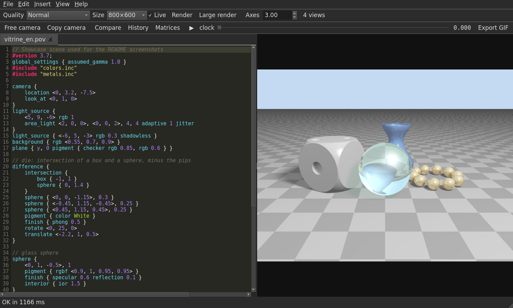
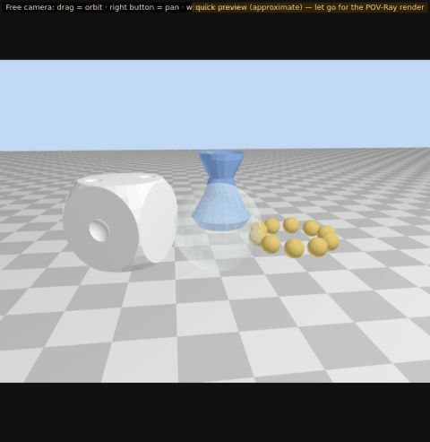
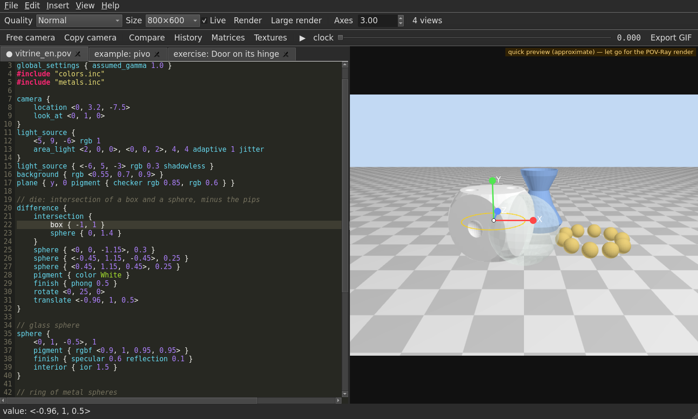
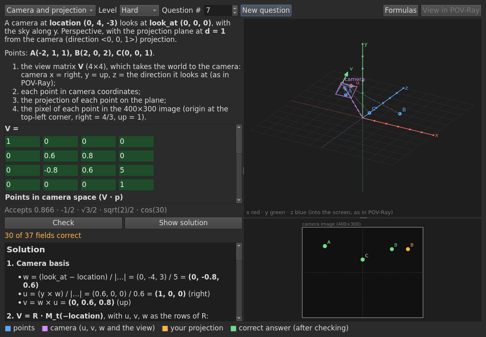
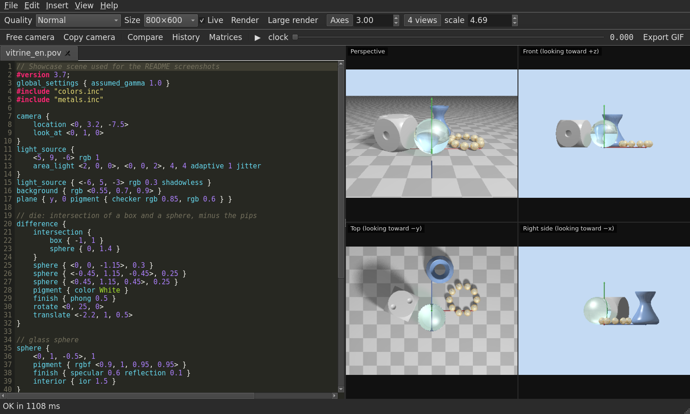
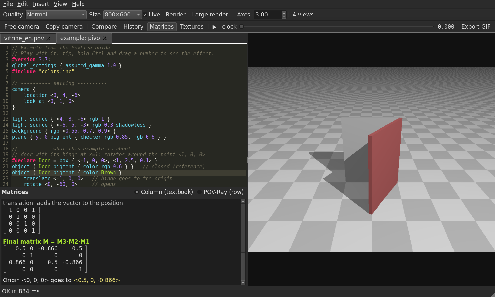
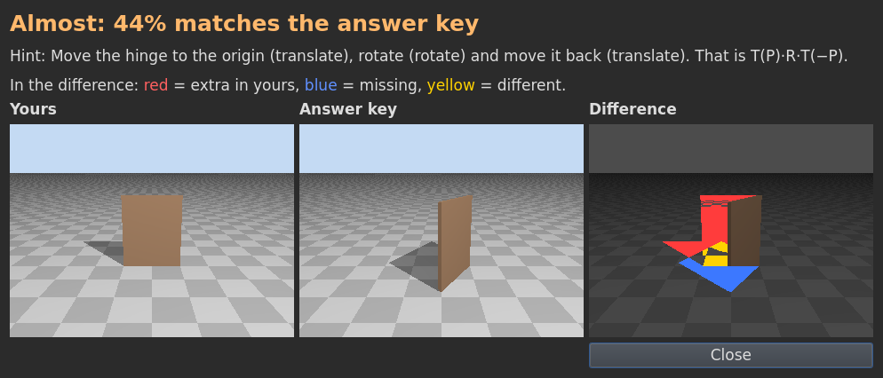
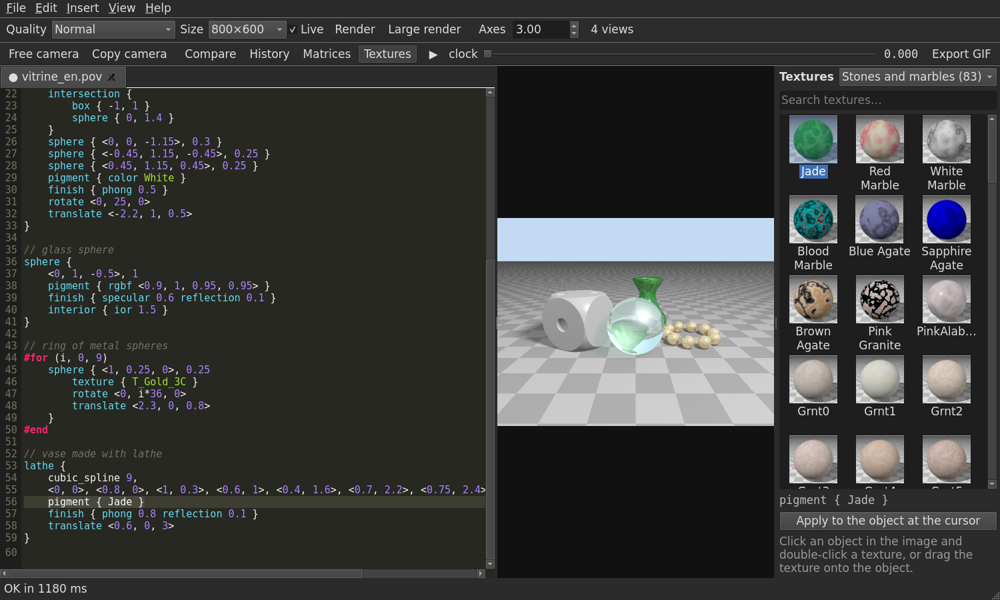

# PovLive

[](https://github.com/willehersomo/povlive/actions/workflows/ci.yml)

**English** · [Português](README.pt-BR.md)

**PovLive** is a [POV-Ray](https://www.povray.org/) scene editor for Linux and Windows, with the code on one side and the image
on the other, rendered as you type. It was made for learning Computer Graphics: besides the live preview, it
shows the **transformation matrices**, lets you **click and drag objects in the image**, has a **free camera
controlled by the mouse**, **four views**, a **texture library with thumbnails**, a **guide with
33 examples** and **auto-graded exercises**.

The interface is available in English and Portuguese.



## Features

**Live preview**
- The scene renders again half a second after you stop typing (first a small preview, then the full image).
- **Ctrl + drag a number** in the code to change its value and watch the image follow.
- Errors highlight the line in red and come with a plain-language explanation; warnings show up in yellow, some
  with an automatic fix.
- `.inc` files open in tabs are used in the render even before you save them.

**Interacting with the image**
- **Instant OpenGL preview**: while you drag the camera, a number, an object or the `clock` bar, the scene is
  drawn right away (over 60 frames per second); when you let go, the POV-Ray render comes in.
- **Click an object** and the cursor jumps to its line in the code; **X/Y/Z arrows** appear to move it along an
  axis, plus a **ring** to rotate it. The `translate`/`rotate` in the code is updated for you (one Ctrl+Z undoes it).
- **Ctrl + drag an object** moves it in the screen plane.
- **Free camera (F6)**: orbit, pan and zoom with the mouse (see [how](#how-the-free-camera-stays-smooth)).
  **Shift+F6** copies the chosen camera into the code.
- **Animation**: the `clock` bar and the ▶ button play the animation smoothly, using the preview.
- **Four views (F7)**: perspective, front, top and side, with orthographic cameras.
- X/Y/Z axes, before/after comparison, version history saved to disk and zoom with a pixel color readout.

<p align="center"></p>



**Learning**
- **Matrix panel (F9)**: the transformations of the object under the cursor as 4×4 matrices, step by step, in
  the column-vector convention (`M = Mₙ···M₁`, as in most textbooks) or in POV-Ray's row-vector convention. The
  math is checked against POV-Ray's own `vtransform` in the tests.
- **Guide (F1)** with 12 topics — solids, transformations, order of transformations, CSG, loops, textures,
  animation — and 33 examples that open in a tab with one click.
- **Exercises** with answer keys: the app renders your answer and the answer key, compares the images and shows
  the difference.
- **2D transformations practice** (Help menu): exam-style questions (translate, scale, rotate, reflect, rotate
  about a point) on a figure; type the final 3×3 matrix and the transformed points and the app grades them, plots
  your answer and shows the step-by-step solution. Each question has a number, so classmates can do the same one.
- **3D practice** (Help menu), in three modes, with a 3D view you rotate with the mouse:
  - **3D transformations**: 4×4 matrices with clockwise `M_rx`, `M_ry`, `M_rz` (the extension of the course's
    `M_r`), the counterclockwise `M_rah…` (which are POV-Ray's `rotate`), reflections and rotation about a line;
  - **camera and projection**: the view matrix of a camera with `location`/`look_at`, the points in camera
    coordinates, the perspective or orthographic projection and the pixel in the image, with the camera's screen
    drawn next to it;
  - **Phong lighting**: L, V, N·L, the reflected vector R, R·V and the intensity I.

  The solution comes step by step, with the equivalent POV-Ray code, and **View in POV-Ray** opens the question's
  scene in a tab. The tests check the math against POV-Ray itself: `vtransform` for the transformations, the
  position of each point in the rendered image and the pixel color for Phong.



| Four views | Matrices | Exercise |
|---|---|---|
|  |  |  |

**Texture library (F10)**: the ready-made textures that come with POV-Ray (metals, woods, stones, glass,
skies, finishes and colors, 434 in all), each one with a thumbnail. **Drag a texture onto an object in the image**
(or double-click it with the cursor in the object) and the code is updated, `#include` included. Thumbnails are
rendered once, in the background, and cached.



**Editor**: syntax highlighting, autocomplete (including names from `#include` files), help on hover, automatic
closing of `{ ( [ < "`, matching brace highlight, comment with Ctrl+/, find and replace, format (Ctrl+Shift+F),
**clicking an `rgb` opens R, G, B sliders** that change the color live (with the full picker one click away), ready-made templates (Insert menu) and tabs. **Go to definition** (F12 or Ctrl+click a name,
also inside `.inc` files), **rename** a name in the whole file (F2) and a **scene tree** (F4) with the objects as a
hierarchy (CSG, `#declare`, loops): click one to go to its code and see it highlighted in the image.

**Output**: PNG, animated GIF (using the `clock` variable) and **export submission** — a `.zip` with the scene,
the `.inc` files, a high-resolution image, the GIF and a README with the command to render it. Large renders show
progress and time left, and can be canceled. **Import OBJ/STL** models: they become a `mesh2` in an `.inc` next to
the scene (axes converted to POV-Ray's), and also show up in the instant preview.

## Install

Download from [Releases](https://github.com/willehersomo/povlive/releases):

- **Windows**: `PovLive-3.7.0-setup.exe` (installer) or `PovLive-3.7.0-windows.zip` (portable). POV-Ray comes
  inside, nothing else to install. The installer is not code-signed yet, so SmartScreen may warn the first time
  (*More info → Run anyway*).
- **Any Linux**: `PovLive-3.7.0-x86_64.AppImage` — make it executable and run it (POV-Ray comes inside):

  ```bash
  chmod +x PovLive-3.7.0-x86_64.AppImage && ./PovLive-3.7.0-x86_64.AppImage scene.pov
  ```
- **Ubuntu, Debian, Pop!_OS, Mint**: the `.deb` package, which uses the system's POV-Ray:

  ```bash
  sudo apt install ./povlive_3.7.0_all.deb    # also installs povray, PyQt5 and Pillow
  povlive scene.pov
  ```

**From source**:

```bash
sudo apt install povray povray-includes python3-pyqt5 python3-pil python3-numpy python3-opengl
git clone https://github.com/willehersomo/povlive.git
python3 povlive/povlive.py scene.pov
```

It works offline. **F1** opens the guide and **Shift+F1** the list of shortcuts.

**Language**: the interface follows the system language (Portuguese or English). To change it, use
**Help > Idioma / Language** and reopen the app, or start it with `POVLIVE_LANG=en` / `POVLIVE_LANG=pt`.

## How it works

The app runs `povray` itself to render, so the result is identical to the command line. Some interesting parts:

### How the free camera stays smooth
Measured: every POV-Ray 3.7 render takes ~0.75 s **even for an empty scene at 160×120**; it is a fixed startup
cost, so making the image smaller does not help. That is why, during any drag, the app uses an **OpenGL
preview**: its own interpreter runs the basics of the language (`#declare`, `#for`, `#while`, `#if`, `#macro`)
and turns the objects into triangles (spheres, boxes, cylinders, cones, tori, planes, prisms, lathe, blob, CSG),
using the same matrices as the matrix panel. Interpreting takes ~5 ms and drawing ~9 ms. In the tests, the
silhouette of the preview matches POV-Ray's (IoU > 0.93). It is an approximation: no shadows or detailed
textures.

**CSG in the preview**: `difference` and `intersection` are actually cut. Every shape has an exact "is this point
inside?" test (with its transformations), and the surface of `A - B` is the part of A outside B plus the part of B
inside A. Triangles near the other pieces are subdivided and cut at the boundary, which is found by bisection
along the edges. On a die with holes, a tube and a half sphere, the silhouette matches POV-Ray's at 98.9%. The cut
is cached: dragging another object, or moving the CSG itself, does not redo the math (~6 ms per frame).

Without OpenGL, the app has a plan B: with the free camera on and the mouse still, it pre-renders the scene at
36 angles × 7 heights (252 images) using POV-Ray's animation mode: 12 low-priority processes, each with a range of
frames (`+SF`/`+EF`), and the scene computes each frame's camera from `frame_number`. The frame order is
interleaved so that the angles closest to the current view are ready first. While dragging, the closest frame
is shown and up to 4 renders of the exact position run in parallel. When zooming and panning, the current image
is warped right away until the exact render arrives.

| | renders only | cache (plan B) | OpenGL preview |
|---|---|---|---|
| first response when dragging | 0.8 s | 0.02 s | 0.01 s |
| new images per second | 4 | 12.5 | > 60 |
| lag behind the mouse | > 100° | 2.5° (10° steps) | none |

### How a click finds the object
The app renders (in the background) a copy of the scene where each object gets a unique flat color: the
original appearance is removed and each block gets
`texture { pigment { rgb <id> } finish { emission 1 ... } }`, with `File_Gamma=1.0`, `ambient_light 0` and no
antialiasing, so the color in the PNG is exact. The color of the clicked pixel tells which block of code made
it. Objects inside `#declare` are not marked, so that each `object { Name }` gets its own color.

### Translation
Texts stay in Portuguese in the code and go through `tr()`; the English version lives in
`povlive_app/traducoes_en.py`, and the guide and exercises have parallel English versions. A test scans the
code for every marked text and fails if any is missing a translation, and another one opens the window in
English and fails if any Portuguese text shows up.

### Structure

```
povlive.py              launcher
povlive_app/
  janela.py             main window, tabs and render engine (preview → final, 4 views)
  recursos.py           matrices, warnings, selection/dragging in the image, exercises, export
  editor.py             code editor (syntax, pairs, autocomplete, search)
  visor.py              image viewer (zoom, free camera, highlight, arrows), 4 views, history
  previa3d.py           instant preview: scene interpreter + OpenGL drawing
  csg.py                difference/intersection in the preview (solids, subdivision, cutting)
  interacao.py          preview while dragging, move/rotate arrows, smooth animation
  cache_orbita.py       orbit cache for the free camera
  sdl.py                reading POV-Ray code: blocks, expressions, transformations
  matrizes.py           4×4 matrices in both conventions
  selecao.py            unique colors per object (click/drag)
  texturas.py, biblioteca.py  texture library (catalog, applying to the code, thumbnails, panel)
  arvore.py, navegar.py  scene tree, go to definition, rename
  importar.py           OBJ/STL import
  treino2d.py, treino2d_ui.py  2D transformations practice
  treino3d.py, treino3d_ui.py  3D practice: transformations, camera and Phong
  plataforma.py         Linux/Windows differences (POV-Ray program, paths, folders)
  i18n.py, traducoes_en.py  interface language
  pov.py, guia.py, guia_en.py, exercicios.py, avisos.py, formatador.py, entrega.py, fila.py
tests/                  tests (pytest, headless Qt)
empacotamento/          .deb, AppImage and Windows (POV-Ray compiled with Cygwin, PyInstaller, Inno Setup)
docs/                   screenshots and the script that generates them
extras/povlive_web.py   first version (editor in the browser)
```

The code is written in Portuguese (it started as a study project for a Brazilian CG course); the interface,
this README and the guide are available in English.

## Tests

```bash
QT_QPA_PLATFORM=offscreen python3 -m pytest -q
```

There are 226 tests: code parsing, matrices compared with POV-Ray, the formatter (the image before and after
formatting must be identical), selection by color, warnings, the 33 guide examples in both languages (none may
produce an error or warning), the 7 exercises (the answer key passes and the starting code does not), the
translation, the texture library (every category renders without warnings, dragging a texture onto an object),
the editor, the scene tree, go to definition and rename, OBJ/STL import, the 2D practice (the course convention and
the grading), the 3D practice (the math checked against POV-Ray: transformations, camera pixel and Phong color), integration tests that open the app, type, click and drag on the image, export a submission and
check the history, and the OpenGL preview (its silhouette, CSG included, must match POV-Ray's). CI runs everything
on Linux and Windows, measures coverage (at least 70%) and builds the `.deb`, the AppImage and the Windows
installer; on a `v*` tag, everything is published in Releases. See also [CONTRIBUTING.md](CONTRIBUTING.md).

To regenerate the screenshots: `POVLIVE_LANG=en python3 docs/gerar_imagens.py` (English, `docs/img/en`) and
`POVLIVE_LANG=pt python3 docs/gerar_imagens.py` (Portuguese, `docs/img`).

## License

MIT — see [LICENSE](LICENSE).
