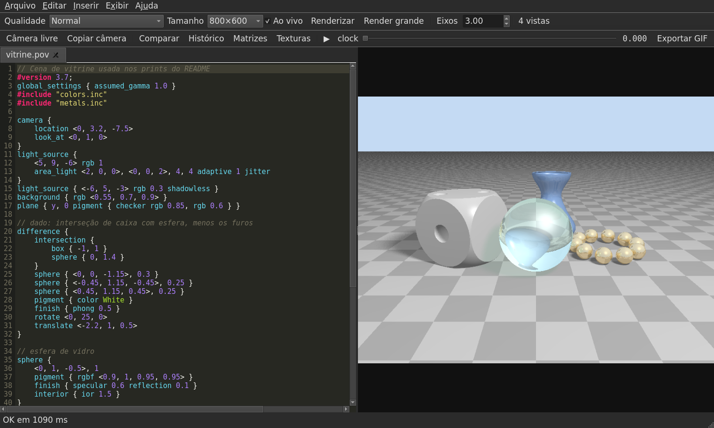
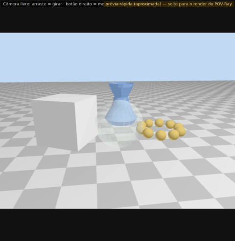
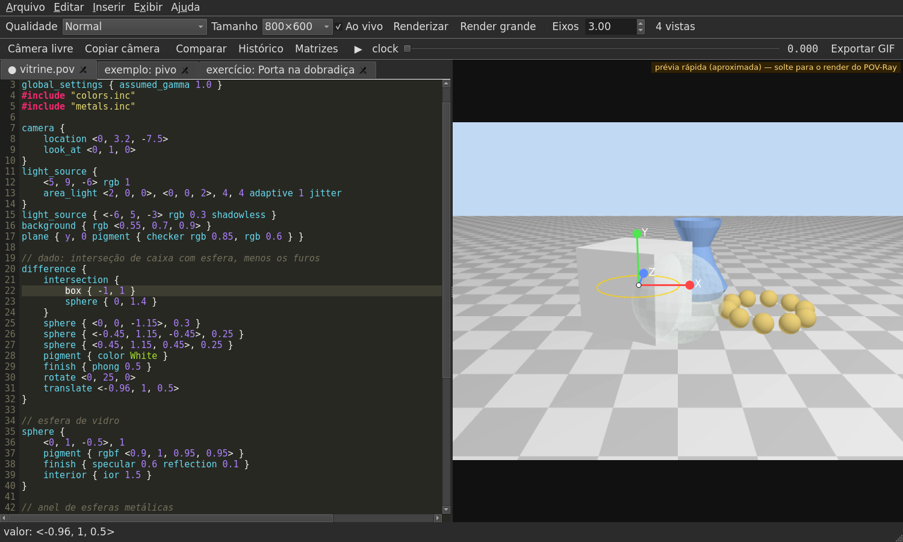
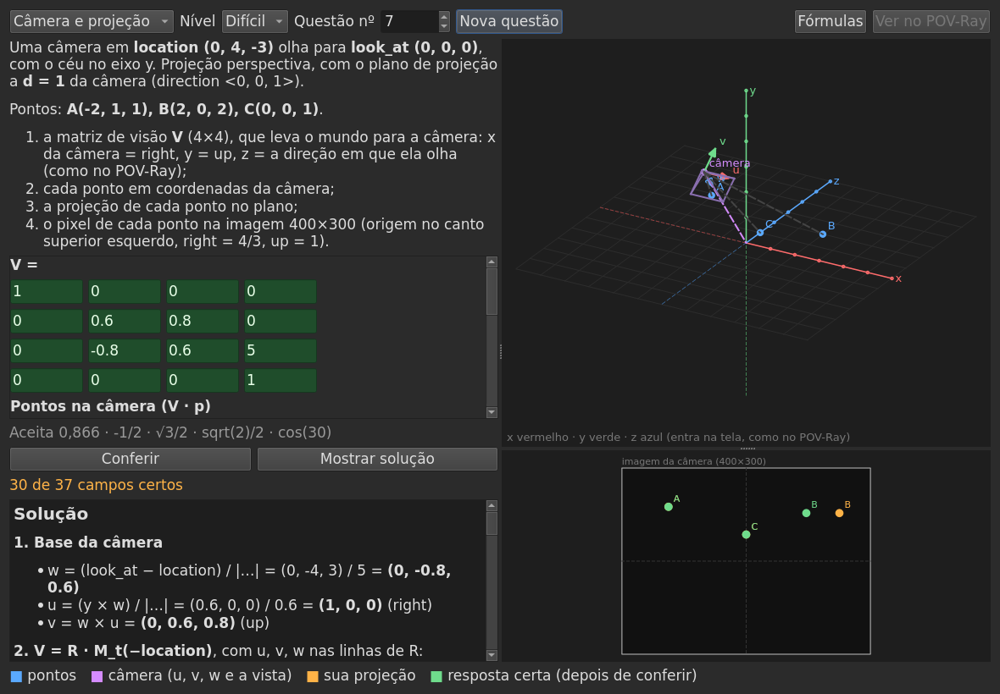
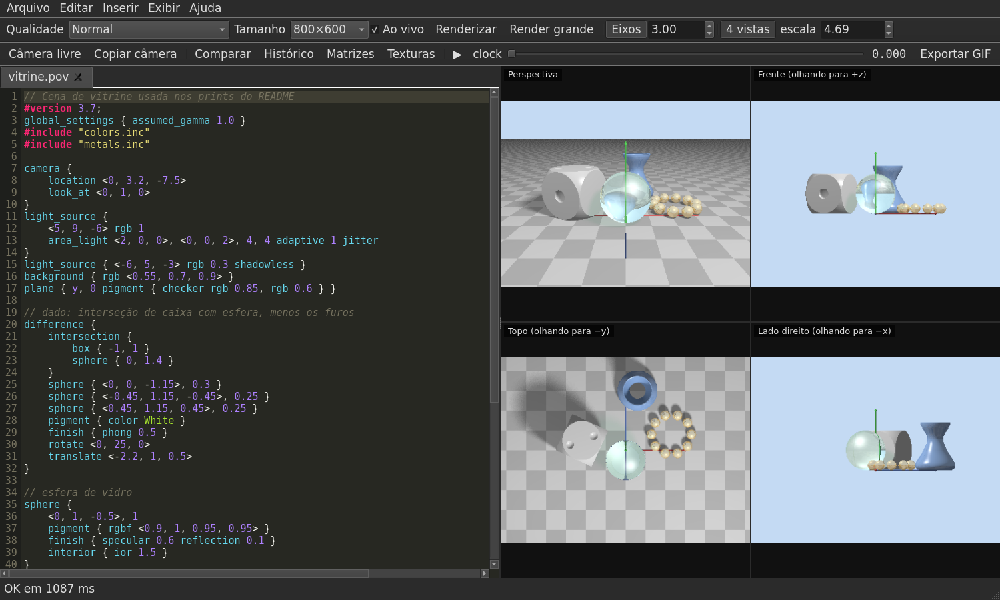
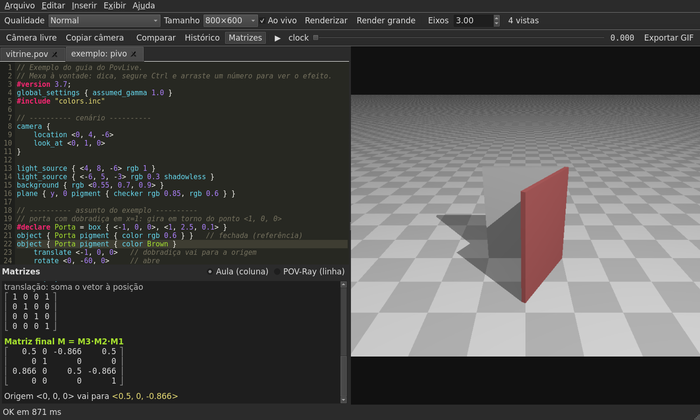
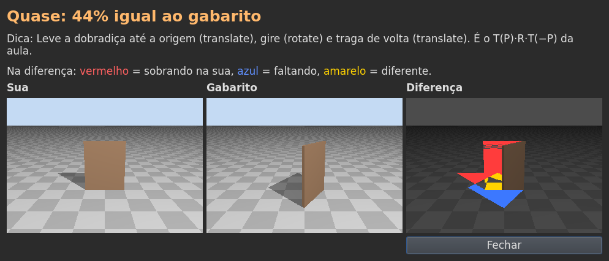
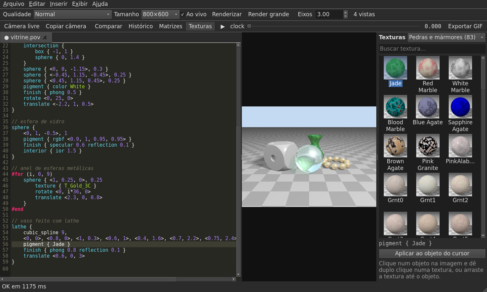

# PovLive

[](https://github.com/willehersomo/povlive/actions/workflows/ci.yml)

[English](README.md) · **Português**

**PovLive** é um editor de cenas [POV-Ray](https://www.povray.org/) para Linux e Windows, com o código de um lado e a imagem do outro,
renderizada enquanto você digita. Foi feito para estudar Computação Gráfica: além do preview ao vivo, ele
mostra as **matrizes das transformações**, deixa **clicar e arrastar objetos na imagem**, tem **câmera livre
com o mouse**, **quatro vistas**, uma **biblioteca de texturas com miniaturas**, um **guia com 33 exemplos** e **exercícios corrigidos automaticamente**.



## Recursos

**Preview ao vivo**
- A cena renderiza de novo meio segundo depois que você para de digitar (primeiro uma prévia pequena, depois a completa).
- **Ctrl + arrastar um número** no código muda o valor e a imagem acompanha.
- Erros marcam a linha em vermelho e vêm explicados em português; avisos aparecem em amarelo, alguns com correção automática.
- Os `.inc` abertos em abas entram no render mesmo sem salvar.

**Interagir com a imagem**
- **Prévia instantânea em OpenGL**: enquanto você arrasta a câmera, um número, um objeto ou a barra do `clock`,
  a cena é desenhada na hora (mais de 60 quadros por segundo); ao soltar, vem o render do POV-Ray.
- **Clique num objeto** e o cursor vai para a linha dele no código; aparecem **setas X/Y/Z** para mover num eixo
  e um **anel** para girar. O `translate`/`rotate` no código é atualizado sozinho (um Ctrl+Z desfaz).
- **Ctrl + arrastar um objeto** move ele no plano da tela.
- **Câmera livre (F6)**: girar, mover e aproximar com o mouse (veja [como](#como-a-câmera-livre-fica-fluida)).
  **Shift+F6** copia a câmera escolhida para o código.
- **Animação**: a barra do `clock` e o ▶ tocam a animação suave, com a prévia.
- **Quatro vistas (F7)**: perspectiva, frente, topo e lado, com câmeras ortográficas.
- Eixos X/Y/Z, comparação antes/depois, histórico de versões salvo em disco e zoom com leitura do pixel.

<p align="center"></p>



**Estudo**
- **Painel de matrizes (F9)**: as transformações do objeto sob o cursor como matrizes 4×4, passo a passo, na convenção
  da aula (ponto em coluna, `M = Mₙ···M₁`, `M_r` horária) ou na do POV-Ray (ponto em linha). As contas são conferidas
  contra o `vtransform` do próprio POV-Ray nos testes.
- **Guia (F1)** com 12 tópicos — sólidos, transformações, ordem das transformações, CSG, laços, texturas, animação —
  e 33 exemplos que abrem numa aba com um clique.
- **Exercícios** com gabarito: o app renderiza a sua resposta e o gabarito, compara as imagens e mostra a diferença.
- **Treino de transformações 2D** (menu Ajuda): questões como as da prova (translação, escala, `M_r` horária,
  `M_rah`, `M_fx`, `M_fy`, rotação e escala em torno de um ponto) sobre uma figura, como a A(1,1) B(2,1) C(2,2) D(1,4)
  da aula. Você digita a matriz 3×3 final e os pontos; o app corrige, desenha a sua resposta e mostra a solução passo
  a passo. Cada questão tem um número, então dá para fazer a mesma que um colega.
- **Treino 3D** (menu Ajuda), em três modos, com uma vista 3D que gira com o mouse:
  - **transformações 3D**: matrizes 4×4 com `M_rx`, `M_ry`, `M_rz` horárias (a extensão do `M_r` da aula),
    as anti-horárias `M_rah…` (que são o `rotate` do POV-Ray), reflexões e rotação em torno de uma reta;
  - **câmera e projeção**: a matriz de visão de uma câmera com `location`/`look_at`, os pontos em coordenadas da
    câmera, a projeção perspectiva ou ortográfica e o pixel na imagem, com a tela da câmera desenhada ao lado;
  - **iluminação de Phong**: L, V, N·L, o vetor refletido R, R·V e a intensidade I.

  A solução vem passo a passo, com o código equivalente em POV-Ray, e **Ver no POV-Ray** abre a cena da questão
  numa aba. Os testes conferem as contas com o próprio POV-Ray: o `vtransform` das transformações, a posição de
  cada ponto na imagem renderizada e a cor do pixel no Phong.



| Quatro vistas | Matrizes | Exercício |
|---|---|---|
|  |  |  |

**Biblioteca de texturas (F10)**: as texturas prontas que vêm com o POV-Ray (metais, madeiras, pedras, vidros,
céus, acabamentos e cores, 434 ao todo), cada uma com miniatura. **Arraste uma textura até um objeto na imagem**
(ou dê duplo clique nela com o cursor no objeto) e o código é atualizado, com o `#include` junto. As miniaturas são
renderizadas uma vez, em segundo plano, e ficam guardadas.



**Editor**: destaque de sintaxe, autocompletar (inclusive nomes dos `#include`), ajuda ao passar o mouse, fechamento
automático de `{ ( [ < "`, par de chaves destacado, comentar com Ctrl+/, buscar e substituir, formatar (Ctrl+Shift+F),
**clicar num `rgb` abre uma escala R, G, B** que muda a cor ao vivo (com o seletor completo a um clique), modelos prontos (menu Inserir) e abas. **Ir para a definição** (F12 ou Ctrl+clique num
nome, também dentro de `.inc`), **renomear** um nome no arquivo inteiro (F2) e a **árvore da cena** (F4), com os
objetos em hierarquia (CSG, `#declare`, laços): clicar num deles leva ao código e destaca o objeto na imagem.

**Saída**: PNG, GIF da animação (variável `clock`) e **exportar entrega** — um `.zip` com a cena, os `.inc`, a imagem
em alta, o GIF e um LEIAME com o comando para renderizar. Renders grandes mostram o progresso e o tempo que falta, e
podem ser cancelados. **Importar modelos OBJ/STL**: viram um `mesh2` num `.inc` ao lado da cena (com os eixos
convertidos para os do POV-Ray) e aparecem também na prévia instantânea.

## Instalar

Baixe em [Releases](https://github.com/willehersomo/povlive/releases):

- **Windows**: `PovLive-3.7.0-setup.exe` (instalador) ou `PovLive-3.7.0-windows.zip` (portátil). O POV-Ray vem
  junto, não precisa instalar mais nada. O instalador ainda não tem assinatura digital, então o SmartScreen pode
  avisar na primeira vez (*Mais informações → Executar assim mesmo*).
- **Qualquer Linux**: `PovLive-3.7.0-x86_64.AppImage` — dê permissão de execução e rode (o POV-Ray vem junto):

  ```bash
  chmod +x PovLive-3.7.0-x86_64.AppImage && ./PovLive-3.7.0-x86_64.AppImage cena.pov
  ```
- **Ubuntu, Debian, Pop!_OS, Mint**: o pacote `.deb`, que usa o POV-Ray do sistema:

  ```bash
  sudo apt install ./povlive_3.7.0_all.deb    # instala também povray, PyQt5 e Pillow
  povlive cena.pov
  ```

**Direto do código**:

```bash
sudo apt install povray povray-includes python3-pyqt5 python3-pil python3-numpy python3-opengl
git clone https://github.com/willehersomo/povlive.git
python3 povlive/povlive.py cena.pov
```

Funciona offline. **F1** abre o guia e **Shift+F1** a lista de atalhos. A interface segue o idioma do sistema
(português ou inglês) e pode ser trocada em **Ajuda > Idioma / Language**.

## Como funciona

O app chama o próprio `povray` para renderizar; o resultado é idêntico ao da linha de comando. Algumas partes
interessantes:

### Como a câmera livre fica fluida
Medindo, todo render do POV-Ray 3.7 leva ~0,75 s **mesmo para uma cena vazia em 160×120** — é um custo fixo de
inicialização. Diminuir a imagem não ajuda. Por isso, durante qualquer arraste o app usa uma **prévia em OpenGL**:
um interpretador próprio executa o básico da linguagem (`#declare`, `#for`, `#while`, `#if`, `#macro`) e transforma
os objetos em triângulos (esferas, caixas, cilindros, cones, toros, planos, prismas, lathe, blob, CSG), com as
mesmas matrizes do painel de matrizes. Interpretar leva ~5 ms e desenhar ~9 ms. Nos testes, a silhueta da prévia
coincide com a do POV-Ray (IoU > 0,93). É uma aproximação: sem sombras nem texturas detalhadas.

**CSG na prévia**: `difference` e `intersection` são recortados de verdade. Cada forma tem um teste exato de "este
ponto está dentro?" (com as transformações), e a superfície de `A - B` é a parte de A fora de B mais a parte de B
dentro de A. Os triângulos perto das outras peças são subdivididos e cortados na fronteira, achada por bisseção ao
longo das arestas. Num dado com furos, um tubo e uma meia esfera, a silhueta bate 98,9% com a do POV-Ray. O
recorte fica guardado: arrastar outro objeto, ou mover o próprio CSG, não refaz as contas (~6 ms por quadro).

Sem OpenGL, o app usa um plano B: com a câmera livre ligada e o mouse parado, ele pré-renderiza
a cena em 36 ângulos × 7 alturas (252 imagens) usando o modo de animação do POV-Ray: 12 processos em prioridade baixa,
cada um com uma faixa de quadros (`+SF`/`+EF`), e a cena calcula a câmera de cada quadro a partir de `frame_number`.
A ordem dos quadros é intercalada para os ângulos mais próximos da vista atual ficarem prontos primeiro.
Ao arrastar, aparece o quadro mais próximo, e até 4 renders da posição exata rodam em paralelo.
No zoom e no mover, a imagem atual é deformada na hora até o render exato chegar.

| | só renders | cache (plano B) | prévia OpenGL |
|---|---|---|---|
| primeira resposta ao arrastar | 0,8 s | 0,02 s | 0,01 s |
| imagens novas por segundo | 4 | 12,5 | > 60 |
| atraso em relação ao mouse | > 100° | 2,5° (passos de 10°) | nenhum |

### Como o clique acha o objeto
O app renderiza (em segundo plano) uma cópia da cena em que cada objeto ganha uma cor única e chapada:
as aparências originais são apagadas, e cada bloco recebe `texture { pigment { rgb <id> } finish { emission 1 ... } }`,
com `File_Gamma=1.0`, `ambient_light 0` e sem antialiasing, para a cor no PNG ser exata. A cor do pixel clicado diz
qual bloco do código o gerou. Objetos dentro de `#declare` não são marcados, para cada `object { Nome }` ter a
própria cor.

### Estrutura

```
povlive.py              lançador
povlive_app/
  janela.py             janela principal, abas e motor de render (prévia → final, 4 vistas)
  recursos.py           matrizes, avisos, seleção/arraste na imagem, exercícios, entrega
  editor.py             editor de código (sintaxe, pares, autocompletar, busca)
  visor.py              visor de imagem (zoom, câmera livre, destaque, setas), 4 vistas, histórico
  previa3d.py           prévia instantânea: interpretador da cena + desenho em OpenGL
  csg.py                difference/intersection na prévia (sólidos, subdivisão, recorte)
  interacao.py          prévia durante os arrastes, setas de mover/girar, animação suave
  cache_orbita.py       cache de órbita da câmera livre
  sdl.py                leitura do código POV-Ray: blocos, expressões, transformações
  matrizes.py           matrizes 4×4 nas duas convenções
  selecao.py            cores únicas por objeto (clique/arraste)
  texturas.py, biblioteca.py  biblioteca de texturas (catálogo, aplicar no código, miniaturas, painel)
  arvore.py, navegar.py  árvore da cena, ir para a definição, renomear
  importar.py           importar OBJ/STL
  treino2d.py, treino2d_ui.py  treino de transformações 2D
  treino3d.py, treino3d_ui.py  treino 3D: transformações, câmera e Phong
  plataforma.py         diferenças entre Linux e Windows (programa do POV-Ray, caminhos, pastas)
  i18n.py, traducoes_en.py  idioma da interface (textos em português no código, tradução inglesa à parte)
  pov.py, guia.py, guia_en.py, exercicios.py, avisos.py, formatador.py, entrega.py, fila.py
tests/                  testes (pytest, Qt sem janela)
empacotamento/          .deb, AppImage e Windows (POV-Ray compilado com o Cygwin, PyInstaller, Inno Setup)
docs/                   prints e o script que gera eles
extras/povlive_web.py   primeira versão (editor no navegador)
```

## Testes

```bash
QT_QPA_PLATFORM=offscreen python3 -m pytest -q
```

São 226 testes: leitura do código, matrizes comparadas com o POV-Ray, formatador (a imagem antes e depois de formatar
tem que ser idêntica), seleção por cor, avisos, os 33 exemplos do guia nos dois idiomas (nenhum pode dar erro
ou aviso), os 7 exercícios (o gabarito passa e o código inicial não), a tradução (todo texto marcado tem versão em
inglês e nenhum texto em português aparece na interface em inglês), a biblioteca de texturas (cada categoria
renderiza sem aviso, arrastar uma textura até um objeto), o editor, a árvore da cena, ir para a definição e
renomear, importar OBJ/STL, o treino 2D (a convenção da aula e a correção), o treino 3D (as contas
conferidas com o POV-Ray: transformações, pixel da câmera e cor do Phong), testes de integração que abrem o app,
digitam, clicam e arrastam na imagem, exportam a entrega e conferem o histórico, e a prévia em OpenGL (a silhueta,
inclusive com CSG, tem que coincidir com a do POV-Ray). O CI roda tudo no Linux e no Windows, mede a cobertura
(mínimo de 70%) e gera o `.deb`, o AppImage e o instalador do Windows; numa tag `v*`, tudo é publicado em
Releases. Veja também o [CONTRIBUTING.md](CONTRIBUTING.md).

Para regerar os prints: `POVLIVE_LANG=pt python3 docs/gerar_imagens.py` (em português, `docs/img`) e
`POVLIVE_LANG=en python3 docs/gerar_imagens.py` (em inglês, `docs/img/en`).

## Licença

MIT — veja [LICENSE](LICENSE).
